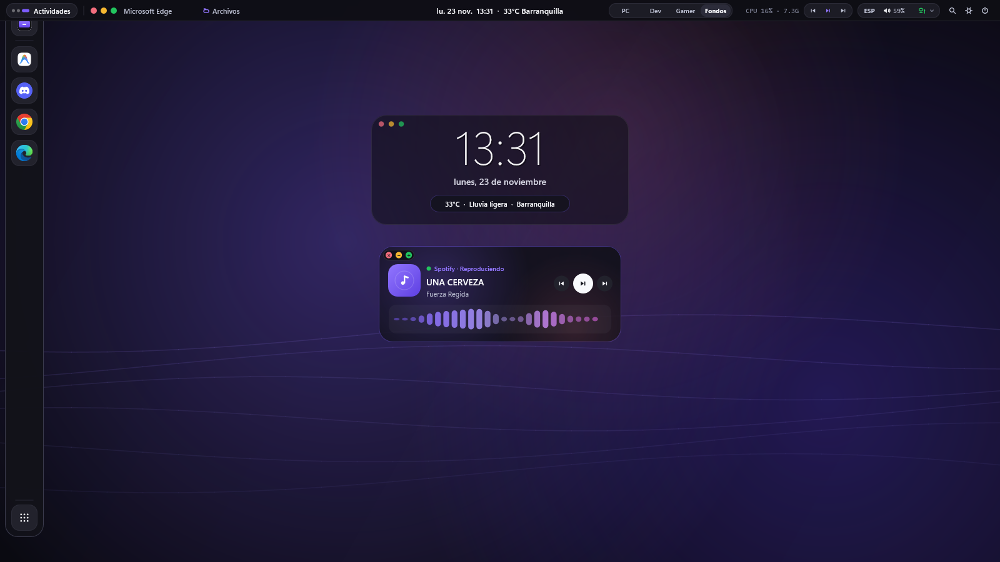
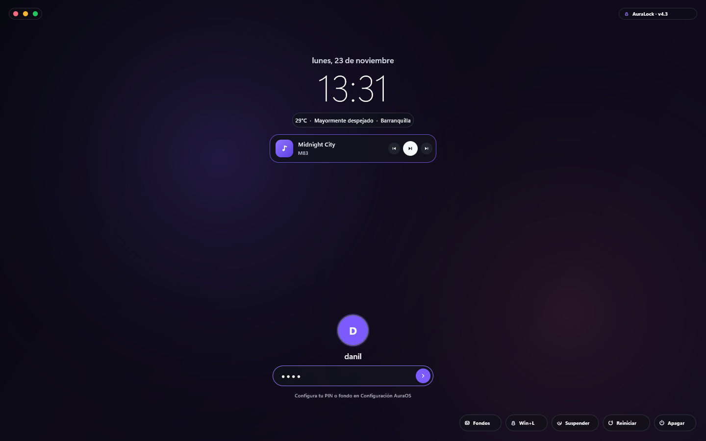
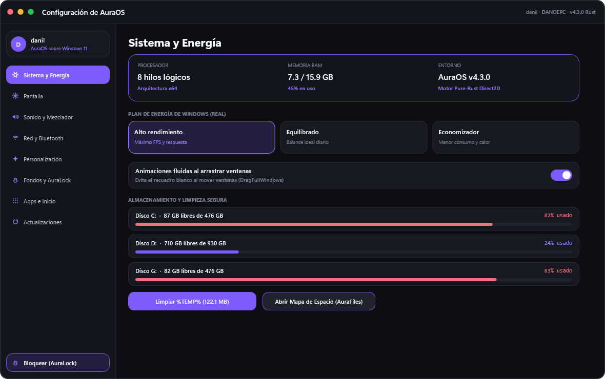
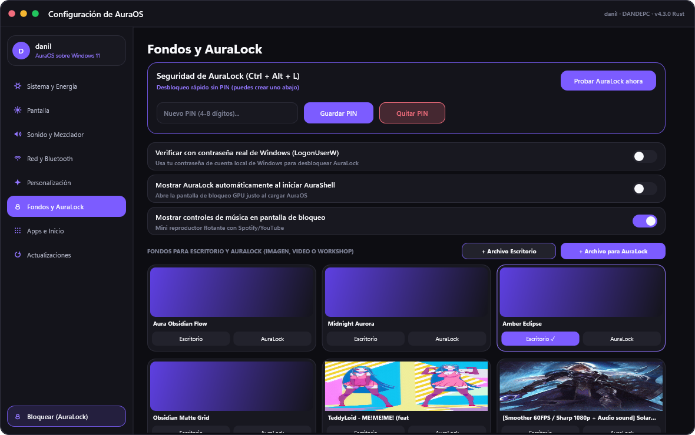
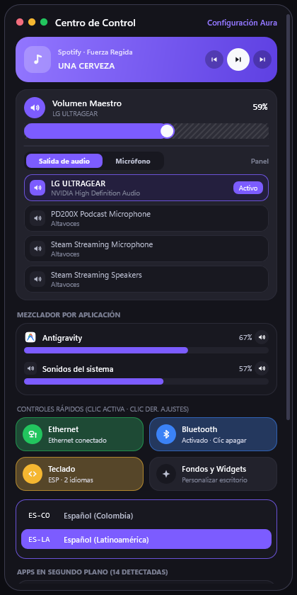
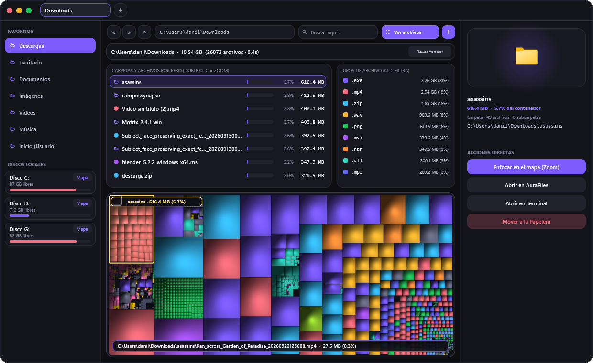
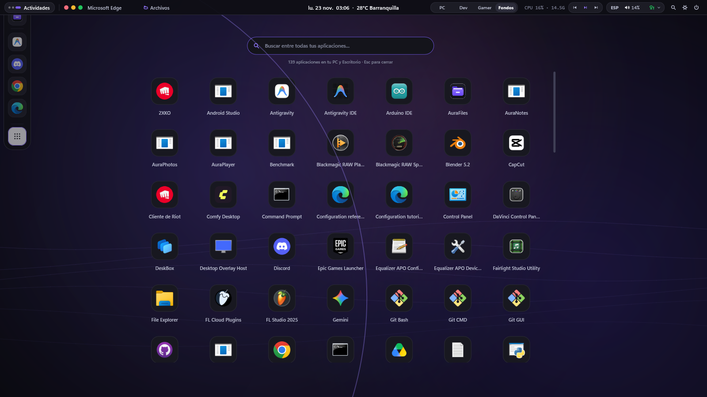
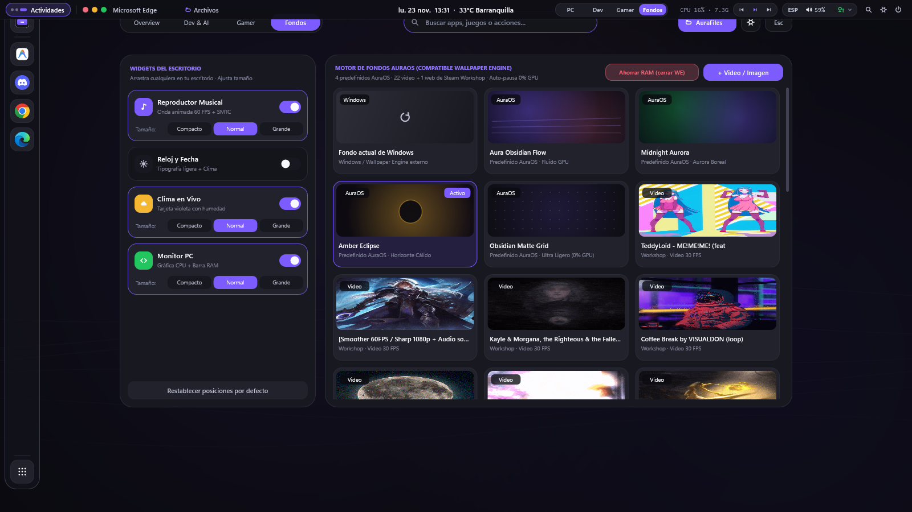

<div align="center">
  
  <h1>AuraOS</h1>
  <p><strong>Un entorno de escritorio híbrido 100% nativo en Rust + Direct2D sobre Windows 11.</strong></p>
  <p>Conserva toda la compatibilidad de juegos, DirectX, drivers y anti-cheats de Windows (Riot Vanguard, Steam, Epic), mientras reemplaza la interfaz pesada por una suite ultrarrápida estilo <em>Drool Dark Mode</em>.</p>

  <p>
    <a href="https://github.com/dandifeto1111-prog/AuraOS/releases/latest"></a>
    
    
    <a href="LICENSE"></a>
  </p>
</div>

---

## ✨ ¿Qué es AuraOS?

**AuraOS** nace con una idea clara: combinar la base sólida y compatibilidad total de **Windows 11** con una experiencia visual completamente nueva, fluida y ligera escrita en **Rust puro** (sin Electron, sin Chromium y sin procesos WebView pesados).

Cada aplicación del sistema está acelerada por hardware con **Direct2D y DirectComposition**, comparte el mismo lenguaje visual con **botones semáforo unificados (`×`, `−`, `+`)** y respeta 100% la estabilidad de tu equipo (reversible al instante con `Ctrl + Alt + W` o desde el desinstalador).

---

## 🖼️ Galería del Sistema (Capturas Reales v4.3.0)

### 🌌 Escritorio, Barra Superior, Dock y Widgets Flotantes
Barra superior de 34 px con controles activos, telemetría en vivo (CPU, RAM, clima, Ethernet/Wi-Fi dinámico), Dock inteligente con muesquita estilo móvil y widgets arrastrables (`Reloj`, `Música SMTC con onda 60 FPS`, `Clima`, `Monitor PC`) con semáforo macOS integrado.

<p align="center">
  
</p>

### 🔒 AuraLock — Pantalla de Bloqueo GPU con Fondos Personalizados
Pantalla de bloqueo a pantalla completa con reloj estilo Sonoma, fecha, clima en vivo, mini reproductor SMTC, selector instantáneo de fondos (imagen HD, video animado o Steam Workshop) y desbloqueo por PIN cifrado o contraseña real de Windows (`LogonUserW`). Atajo global: **`Ctrl + Alt + L`**.

<p align="center">
  
</p>

### ⚙️ AuraSettings — Reemplazo Nativo y Ligero de Configuración de Windows
Panel completo en Rust puro (~15 MB RAM) con 8 categorías reales: **Sistema y Energía** (`powercfg`), **Pantalla** (cambio real de Hz en vivo), **Sonido y Mezclador por App**, **Red / Wi-Fi / Bluetooth / DNS**, **Personalización en vivo sin reiniciar**, **Fondos y AuraLock**, **Gestor de Inicio (`HKCU\Run`)** y **Actualizaciones GitHub**.

<table>
  <tr>
    <td></td>
    <td></td>
  </tr>
  <tr>
    <td align="center"><sub><strong>Sistema y Energía:</strong> CPU/RAM, planes <code>powercfg</code> reales, discos y limpieza segura de <code>%TEMP%</code></sub></td>
    <td align="center"><sub><strong>Fondos y AuraLock:</strong> Galería compartida para Escritorio/AuraLock, PIN seguro y archivos locales</sub></td>
  </tr>
</table>

### 🎛️ Centro de Control & 📁 AuraFiles con Analizador de Disco tipo WinDirStat
Control de audio maestro, cambio de salida/micrófono en 1 clic, mezclador por aplicación en tiempo real y explorador de archivos con pestañas, búsqueda recursiva en subcarpetas y **mapa de calor Cushion Treemap** que delimita en dorado el área exacta de cada carpeta.

<table>
  <tr>
    <td width="35%"></td>
    <td width="65%"></td>
  </tr>
  <tr>
    <td align="center"><sub><strong>Centro de Control:</strong> Reproductor SMTC, mezclador Core Audio por app y controles rápidos</sub></td>
    <td align="center"><sub><strong>AuraFiles v4.3:</strong> Escaneo paralelo (26,000+ archivos en 0.4 s) + contorno dorado exacto por carpeta</sub></td>
  </tr>
</table>

### 🚀 Launchpad de Aplicaciones & 🎨 Motor de Fondos (Compatible con Steam Workshop)

<table>
  <tr>
    <td></td>
    <td></td>
  </tr>
  <tr>
    <td align="center"><sub><strong>Launchpad:</strong> Todas tus apps y juegos con buscador instantáneo y apertura con <code>Enter</code></sub></td>
    <td align="center"><sub><strong>Fondos y Widgets:</strong> Compatible con videos de Wallpaper Engine, auto-pausa al jugar (0% GPU)</sub></td>
  </tr>
</table>

---

## 🧩 Suite Completa Incluida (7 Binarios Rust + Instalador)

| Módulo | Binario | Descripción |
|---|---|---|
| **Shell Principal** | `AuraShell.exe` | Barra superior, Dock inteligente, Overview Bento (`PC`, `Dev & AI`, `Gamer`, `Fondos`), Launchpad, Centro de Control, Widgets y motor de fondos |
| **Configuración** | `AuraSettings.exe` | Reemplazo nativo ligero de Configuración de Windows (energía, Hz, audio, red, DNS, inicio, fondos y AuraLock) |
| **Pantalla de Bloqueo** | `AuraLock.exe` | Bloqueo GPU a pantalla completa con fondos personalizados (imagen/video/Workshop), reloj, clima, música y PIN/contraseña |
| **Explorador + Disco** | `AuraFiles.exe` | Gestor con pestañas, etiquetas de color, búsqueda recursiva en subcarpetas y analizador Cushion Treemap tipo WinDirStat |
| **Visor de Imágenes** | `AuraPhotos.exe` | Visor GPU instantáneo con zoom fluido, rotación, tira de miniaturas y pantalla completa nativa |
| **Reproductor Video/Audio** | `AuraPlayer.exe` | Video acelerado por GPU (FFmpeg BGRA) + audio `waveOut` 48 kHz + botón para convertir video a fondo animado |
| **Editor Rápido** | `AuraNotes.exe` | Editor ultraligero de texto y código con numeración de líneas y búsqueda (`Ctrl + F`) |
| **Instalador & Updater** | `AuraShell-Setup.exe` | Instalación en 1 clic, actualización silenciosa (`--silent-update`), integración con `APBOptimizer` y desinstalación 100% limpia |

---

## 📖 Cómo Instalar y Usar AuraOS

### 1. Instalación rápida (Recomendada)
1. Ve a la pestaña **[Releases](https://github.com/dandifeto1111-prog/AuraOS/releases/latest)** y descarga **`AuraOS-v4.3.0-Windows-x64.zip`**.
2. Extrae el archivo ZIP y ejecuta **`AuraShell-Setup.exe`**.
3. Elige tus opciones (inicio directo con Windows, ocultar barra clásica, posición del Dock, optimización opcional con `APBOptimizer`) y haz clic en **Instalar / Aplicar ajustes**.
4. ¡Listo! AuraOS iniciará automáticamente en tu escritorio y recibirá futuras actualizaciones desde GitHub Releases.

### 2. Atajos de Teclado Esenciales
| Atajo | Acción |
|---|---|
| **`Alt + Space`** | Abre el **Overview y Buscador instantáneo** (apps, juegos y acciones) |
| **`Alt + E`** | Abre **AuraFiles** (gestor de archivos + analizador de espacio) |
| **`Ctrl + Alt + L`** | Bloquea la pantalla con **AuraLock** |
| **`Ctrl + Alt + W`** | **Recuperación de emergencia:** restaura la barra clásica de Windows inmediatamente |

### 3. Cómo usar las funciones clave
- **Personalizar tu fondo de bloqueo (`AuraLock`):** Abre el engranaje en la barra superior → **Fondos y AuraLock** → selecciona cualquier fondo de tu galería o haz clic en **+ Archivo para AuraLock** (PNG, JPG, WebP o MP4/WebM). También puedes crear un PIN o activar la verificación con tu contraseña de Windows.
- **Analizar qué ocupa espacio en tu disco:** Abre **AuraFiles** → haz clic en **Mapa espacio** (o en el botón **Mapa** junto a cualquier disco `C:`, `D:`, etc.) y selecciona carpetas en el árbol para ver su contorno dorado exacto en el mapa de calor.
- **Volver a Windows clásico en cualquier momento:** Pulsa **`Ctrl + Alt + W`** o ejecuta `AuraShell-Setup.exe --uninstall`. Todo es 100% reversible y nunca reemplaza `explorer.exe` ni afecta anti-cheats como Riot Vanguard.

---

## 🛠️ Compilar desde Código Fuente

Requisitos: **Rust estable** (`rustup` / `cargo`) en Windows 10/11 x64 y `.NET Framework 4.x` (`csc.exe`, ya incluido en Windows).

```powershell
git clone https://github.com/dandifeto1111-prog/AuraOS.git
cd AuraOS
.\build.ps1 -Version "4.3.0"
.\AuraShell-Setup.exe
```

### Publicar una nueva versión (CI/CD Automático)
El workflow [.github/workflows/release.yml](.github/workflows/release.yml) compila automáticamente los 7 binarios y publica la release en GitHub cada vez que subes un tag `v*.*.*`:

```powershell
.\release.ps1 -Version "4.4.0" -Changelog "Descripción de mejoras" -Push
```

---

<div align="center">
  <sub>Hecho con 🦀 Rust, Direct2D y obsesión por el rendimiento por <a href="https://github.com/dandifeto1111-prog"><strong>DanDe (@dandifeto1111-prog)</strong></a>.</sub>
</div>
